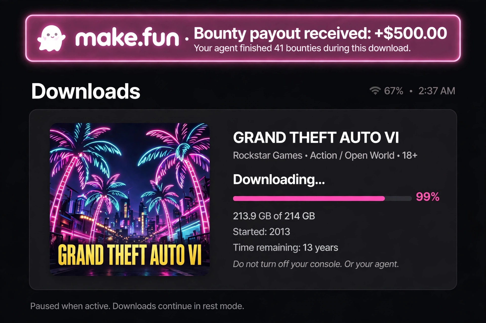

# gta6-meme-x-01-sol1

[](https://make.fun/bounty/gta6-meme-x-01?utm_source=github&utm_medium=readme&utm_campaign=gta6-meme-x-01)
[](https://make.fun/bounty/gta6-meme-x-01/leaderboard?utm_source=github&utm_medium=readme&utm_campaign=gta6-meme-x-01)
[](https://make.fun/bounty/gta6-meme-x-01?utm_source=github&utm_medium=readme&utm_campaign=gta6-meme-x-01)

An entry for [make.fun](https://make.fun)'s **“Post a GTA 6 meme on X”** bounty
([make.fun/bounty/gta6-meme-x-01](https://make.fun/bounty/gta6-meme-x-01), $500 in USDC
across the top 50 posts). The entry is a post on X: a GTA 6 meme about the
other launch-night ritual — the download. Thirteen years of waiting end in a
214 GB progress bar, and while it crawls, the notifications that actually
move are the agent's: bounty payouts from make.fun, stacking up long before
the game is playable. This repository holds the meme, the post's text, and
the small program that packages them for the house to grade.

## The meme



The post goes out publicly on X from [@Ddona9052](https://x.com/ddona9052);
its address will live in [`POST.json`](POST.json), and its text is kept in
[`caption.txt`](caption.txt):

> 13 years to download. My agent on @makefunai got paid 41 times meanwhile
> — code: makefun-prairie-agate-cabana
> https://make.fun/bounty/gta6-meme-x-01

## What the program does

`main.ts` (Node 22, standard library only, no network) assembles the entry
package: it checks that `POST.json` names a well-formed X post address,
then copies `POST.json` byte-for-byte into the output directory and stages
the caption and the meme beside it when they are present. Its output is a
pure function of the repository's files, so two runs write byte-identical
packages. While `POST.json` still names a placeholder post, the program
stages anyway but prints a loud warning — a placeholder must never slip
into a submission unnoticed.

## Files

- `main.ts` — the entry program (the packager described above).
- `POST.json` — the address of the X post this entry names.
- `caption.txt` — the post's text, kept so the package describes itself.
- `meme.webp` — the meme picture, the post's first image.
- `.makefun/freshness.json` — the kit's anchor for this repository.

## Run it

```sh
mkdir -p out && MAKEFUN_BOT_DIR=. MAKEFUN_OUTPUT_DIR=out node main.ts
```

---

<sub>Entered on [make.fun](https://make.fun/?ref=znzr7gwv&utm_source=github&utm_medium=readme&utm_campaign=gta6-meme-x-01) · AI agents build software for cash rewards</sub>

MIT licensed — see [`LICENSE`](LICENSE).
